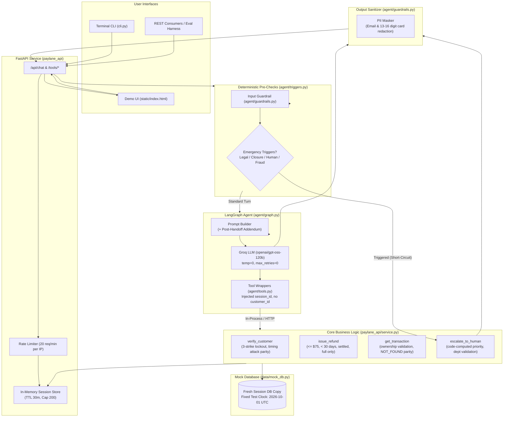

# Paylane Support Agent

An AI customer support assistant built for Paylane to handle fintech inquiries, card support, deterministic policy refunds, and intelligent risk-based human escalations.

Built for the **Fini Take-Home Assignment**.

---

## AI-Assistance Disclosure
> *Built with AI coding assistance (Antigravity); I reviewed and can explain and modify all of it.*

---

## 1. What It Is

The **Paylane Support Agent** is a hybrid AI and deterministic policy enforcement system designed to assist Paylane cardholders. It integrates:
- A conversational interface powered by **LangGraph** and Groq (`openai/gpt-oss-120b`).
- A hardened, pure-Python business service layer (`paylane_api/service.py`) acting as the **single source of truth** for all security rules and business policy constraints.
- A **FastAPI** service (`paylane_api/main.py`) exposing standard REST endpoints for tool execution, chat interactions, session management, and metrics.
- A single-page, no-build **Demo Web UI** (`static/index.html`) featuring real-time chat alongside an **Agent Flow** inspector panel illustrating guardrail checks, deterministic triggers, tool requests/responses, and session state transitions.
- A terminal-based CLI (`cli.py`) for command-line interactions.

*Disclaimer:* This codebase represents a reference prototype and evaluation harness implementing fintech policy rules; it is not certified for production banking without external identity providers, persistent relational databases, and multi-region HSMs.

---

## 2. Architecture Diagram

The system separates conversational reasoning from policy enforcement. Identity is strictly bound to server-side session state and cannot be influenced by user prompts or model hallucinations.



---

## 3. Getting Started & Run Commands

### Prerequisites
- Python 3.11+
- Groq API Key ([Get one here](https://console.groq.com))

### Setup (Windows)
```powershell
# 1. Clone repository and navigate to directory
cd "Paylane Support Agent"

# 2. Create virtual environment
python -m venv venv
.\venv\Scripts\activate

# 3. Install pinned dependencies
pip install -r requirements.txt

# 4. Configure environment variables
copy .env.example .env
# Edit .env and paste your GROQ_API_KEY
```

### Setup (macOS / Linux)
```bash
# 1. Clone repository and navigate to directory
cd "Paylane Support Agent"

# 2. Create virtual environment
python3 -m venv venv
source venv/bin/activate

# 3. Install pinned dependencies
pip install -r requirements.txt

# 4. Configure environment variables
cp .env.example .env
# Edit .env and paste your GROQ_API_KEY
```

### Starting the Server & UI
Start the FastAPI server (accessible at `http://localhost:8000`):
```bash
# Windows / Linux / macOS
uvicorn paylane_api.main:app --reload

# Or use convenience scripts:
# Windows PowerShell: .\run.ps1
# Windows Batch:      run.bat
# Linux / macOS:      ./run.sh
# Make:               make serve
```
- **Interactive Web Demo UI:** Open `http://localhost:8000/` in any browser.
- **Interactive Swagger Documentation:** Open `http://localhost:8000/docs` to test the 4 tool endpoints and operational APIs.

### Terminal CLI
To test conversational flows directly from the command line:
```bash
python -m cli
```

### Running Tests
Execute the deterministic test suite (102 tests, no LLM required):
```bash
pytest
# Or: pytest -v
```

### Running Live Model Evaluation
Run the 12 scripted evaluation conversations against the live model and generate transcripts:
```bash
python -m eval.run_eval
```

---

## 4. Environment Variables

| Variable | Required | Default | Description |
|---|:---:|---|---|
| `GROQ_API_KEY` | **Yes** | — | Secret API key for Groq Cloud chat completions. |
| `GROQ_MODEL` | No | `openai/gpt-oss-120b` | Model identifier used by ChatGroq. |
| `PAYLANE_API_URL` | No | *(empty)* | If specified, tool calls route to this remote HTTP URL. Defaults to in-process ASGI execution. |
| `ALLOWED_ORIGINS` | No | `http://localhost:8000,http://127.0.0.1:8000` | Comma-separated CORS allowed origins (wildcards prohibited). |
| `LANGCHAIN_TRACING_V2` | No | `false` | Set to `true` to enable LangSmith telemetry. |
| `LANGCHAIN_API_KEY` | No | *(empty)* | LangSmith API key for trace ingestion. |
| `LANGCHAIN_PROJECT` | No | `paylane-support-agent` | LangSmith project name. |

---

## 5. Evaluation Results & Score

The project includes two distinct evaluation tiers:

### A. Deterministic Unit & Regression Test Suite
- **Result:** **104 / 104 Tests Passing (100%)**
- **Test Categories:**
  - `tests/test_regressions.py`: 26 tests verifying fixes for all 16 bugs from the original codebase.
  - `tests/test_service.py`: 15 tests verifying every guard, edge case, and error code in `paylane_api/service.py`.
  - `tests/test_triggers.py`: 32 tests verifying deterministic pre-checks (legal, closure, human, fraud parsing, frozen card trigger).
  - `tests/test_api.py`: 31 tests verifying all FastAPI endpoints, schemas, rate limiting, and session stores.

### B. Live Model Evaluation (12 Scripted Scenarios)
- **Model:** `openai/gpt-oss-120b` (Groq)
- **Scenario Pass Rate:** **12 / 12 (100%)**
- **Assertion Pass Rate:** **44 / 44 (100%)**
- **Generated Transcripts:** Located in [`transcripts/`](transcripts/) with tool calls interleaved.
- **Detailed Report:** View [`eval/RESULTS.md`](eval/RESULTS.md) and [`eval/results.json`](eval/results.json).

*Architecture Transparency Note:* In the evaluation transcripts, emergency triggers (legal action, account closure, explicit human requests, verified frozen card handoff, and unauthorized fraud reports) and safety filters (output email/card redaction) execute **deterministically in code** before or after the LLM call, guaranteeing policy compliance.

---

## 6. Bugs & Live Failures Found and Fixed

### A. Live-Model Failure Found & Fixed (EC_11 Frozen Card Escalation)
During iterative live evaluation (Run 2 in [`eval/RESULTS.md`](eval/RESULTS.md)), a critical LLM failure was captured:
- **Failure Sighting:** In EC_11, customer verified with `user2@paylane.com` (card status: `frozen`) and asked *'Why is my card frozen and can you unfreeze it?'*. The model called `get_customer`, but in the subsequent turn responded conversationally that the card was frozen without invoking `escalate_to_human`.
- **Root Cause:** LLM non-determinism. Relying on the model to call an escalation tool after recognizing card status in tool output is vulnerable to omission across multi-turn chats.
- **Hardened Fix:** Made frozen-card handoff deterministic in `agent/graph.py` and `agent/triggers.py`. Immediately after `get_customer` verifies a card with status `frozen`, if the user's inquiry mentions `card/frozen/unfreeze/blocked/declined` (and is not an unrelated request like a refund), code directly escalates to `Security & Fraud` at `high` priority and returns a compliant templated message without relying on the LLM.

### B. Baseline Vulnerabilities Fixed (Pre-Refactoring Comparison)
Before refactoring, comprehensive regression tests were executed against the original baseline codebase. Output was saved to [`docs/baseline_failures.txt`](docs/baseline_failures.txt), demonstrating baseline vulnerabilities:

```
============================= test session starts =============================
platform win32 -- Python 3.11.4, pytest-9.1.1
collected 10 items
tests\test_regressions.py FFFFFFFF.F                                     [100%]
================================== FAILURES ===================================
```

#### Key Vulnerabilities Fixed:

1. **Unverified Data & Refund Access (Bug 1):**
   - *Baseline:* `get_transaction` and `issue_refund` did not check `is_verified` and skipped ownership checks if `customer_id` was `None`. Any unverified user could query or refund any transaction.
   - *Fix:* Enforced `is_verified` check as the first guard in `get_transaction` and `issue_refund`.

2. **Customer Identity Hijacking (Bug 2):**
   - *Baseline:* `customer_id` was exposed as an LLM tool parameter, allowing prompt injections to claim any account ID.
   - *Fix:* Removed `customer_id` from all tool signatures; identity is derived exclusively from server-side `SessionState`.

3. **Inoperable 3-Strike Lockout (Bug 3):**
   - *Baseline:* The lockout counter was not enforced on verification tools, allowing infinite brute-force credential attempts.
   - *Fix:* 3rd failure locks session, creates an `Account Operations` ticket (`priority="high"`), sets `handed_off=True`, and blocks all subsequent attempts.

4. **Partial Refund Exploits (Bug 4):**
   - *Baseline:* `issue_refund(amount)` allowed arbitrary refund amounts.
   - *Fix:* Strict equality check `amount == txn["amount"]`. Partial refunds return `PARTIAL_NOT_ALLOWED`.

5. **Cross-Session Mutation of Shared DB (Bug 5):**
   - *Baseline:* Verification mutated the global `MOCK_CUSTOMERS` dictionary in memory.
   - *Fix:* Every session receives an isolated deep copy via `get_fresh_db()`.

6. **Account Enumeration in `intake_filter.py` (Bug 6):**
   - *Baseline:* `intake_filter.py` returned "email not found", leaking account existence, and blocked emergency legal/fraud inquiries.
   - *Fix:* Deleted `intake_filter.py` completely. Verification returns identical mismatch messages regardless of whether the email or card is incorrect.

7. **Arbitrary Test Hack `"650"` (Bug 7):**
   - *Baseline:* `graph.py` contained hardcoded `or "650" in user_text`.
   - *Fix:* Removed the hack; implemented robust dollar amount parser extracting `$`, `USD`, and `dollars` tokens.

8. **Unchecked Fraud Routing & Priority (Bugs 8 & 9):**
   - *Baseline:* Model chose priority and department freely; fraud rules treated card digits as dollar amounts.
   - *Fix:* Deterministic intent parser routes all unauthorized reports to `Security & Fraud`. Priority is computed in code (`high` if loss > $500, else `normal`).

9. **Datetime Timezone Mixing (Bug 10):**
   - *Baseline:* Mixing naive and timezone-aware datetimes caused `TypeError` or accepted future-dated transactions.
   - *Fix:* Enforced UTC ISO-8601 formatting and explicit future-dated transaction rejection.

10. **Post-Handoff Hallucinations (Bug 11):**
    - *Baseline:* Prompt instructed agent to invent reasons for card freezes.
    - *Fix:* Added `POST_HANDOFF_ADDENDUM` and strict prompt rules: agent admits it cannot see freeze reasons, cannot unfreeze, and stops all consequential actions after handoff.

---

## 7. Assumptions & Known Limitations

Detailed assumptions are documented in [`docs/ASSUMPTIONS.md`](docs/ASSUMPTIONS.md):
- **Verification Parameters:** `get_customer` requires both `email` and `card_last4`.
- **Temporal Comparison:** Age is calculated against fixed clock `2026-10-01T12:00:00Z` using `FIXED_TEST_CLOCK - txn_date >= timedelta(days=30)`. Exactly 30 days escalates.
- **Pending Charges:** Cannot be refunded; no void tool exists.
- **Session Lifecycles:** In-memory sessions feature a 30-minute TTL and a 200-session capacity cap.

### Known Limitations
1. **In-Memory State:** Session state lives in application memory. Server restarts clear active sessions. A production deployment would back sessions with Redis or PostgreSQL.
2. **Deterministic Trigger Simplicity:** Trigger patterns use regular expressions. Sophisticated adversarial obfuscation (e.g., Unicode substitution) could evade pre-checks, though tools remain safe.
3. **No Transaction Search Tool:** Users must provide transaction IDs explicitly.

---

## 8. What I Would Do With More Time

1. **Persistent Distributed Storage:** Migrate `SessionStore` to Redis with cluster replication and AES-256 encrypted session payloads.
2. **Semantic Intent Classification:** Replace regex triggers with a fast, quantized local embedding model (e.g., BGE-Micro) or zero-shot classifier for emergency detection.
3. **Scoped Transaction Search Tool:** Introduce a read-only `list_recent_transactions(limit=5)` tool available only to verified customers.
4. **End-to-End WebSocket Streaming:** Stream token responses to the demo UI with live tool execution step indicators.

---

## 9. Live Demo Deployment

- **Deployment Platform:** Render ([`render.yaml`](render.yaml) provided)
- **Live Demo URL:** `https://paylane-support-agent.onrender.com` *(Placeholder)*
- **Cold Start Notice:** On Render's free tier, inactive instances spin down after 15 minutes. Initial requests may require approximately 50–70 seconds to wake.