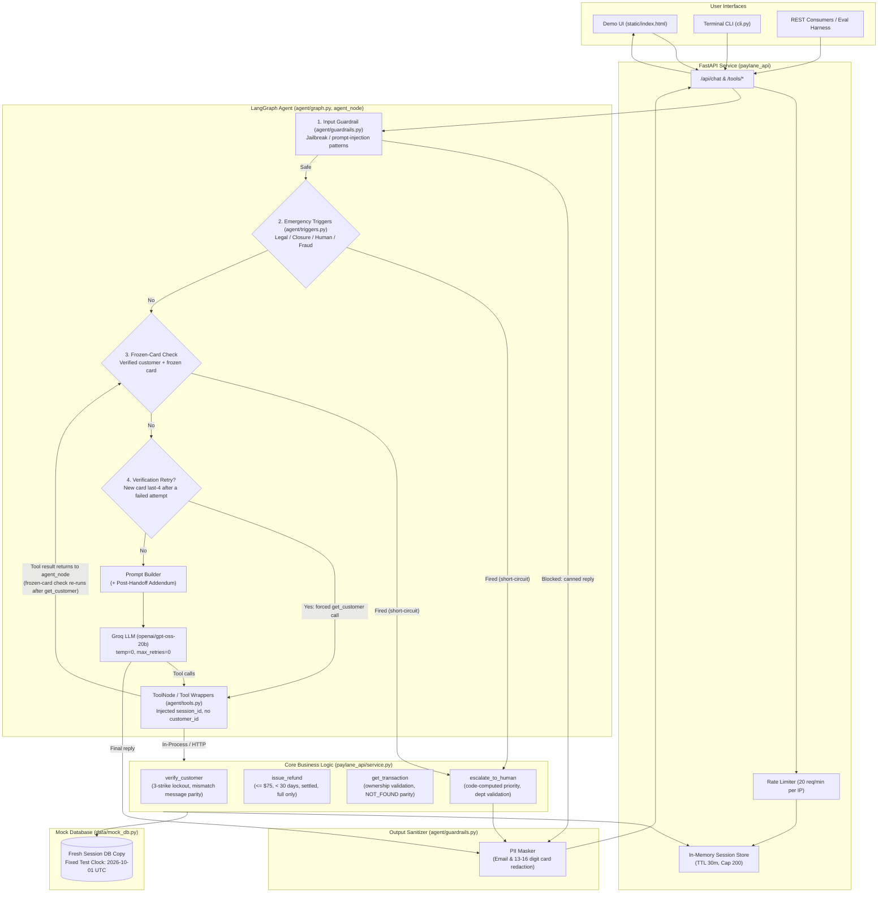

# Paylane Support Agent

An AI customer support assistant built for Paylane to handle fintech inquiries, card support, deterministic policy refunds, and intelligent risk-based human escalations.

Built for the **Fini Take-Home Assignment**.

---

## AI-Assistance Disclosure
> *Built with AI coding assistance (Antigravity); I reviewed and can explain and modify all of it.*

---

## 1. What It Is

The **Paylane Support Agent** is a hybrid AI and deterministic policy enforcement system designed to assist Paylane cardholders. It integrates:
- A conversational interface powered by **LangGraph** and Groq (`openai/gpt-oss-20b`).
- A hardened, pure-Python business service layer (`paylane_api/service.py`) acting as the **single source of truth** for all security rules and business policy constraints.
- A **FastAPI** service (`paylane_api/main.py`) exposing standard REST endpoints for tool execution, chat interactions, and session management.
- A single-page, no-build **Demo Web UI** (`static/index.html`) with real-time chat and a dropdown of the 12 evaluation scenarios.
- A terminal-based CLI (`cli.py`) for command-line interactions.

*Disclaimer:* This codebase represents a reference prototype and evaluation harness implementing fintech policy rules; it is not certified for production banking without external identity providers, persistent relational databases, and multi-region HSMs.

---

## 2. Architecture Diagram

The system separates conversational reasoning from policy enforcement. Identity is strictly bound to server-side session state and cannot be influenced by user prompts or model hallucinations.



*Reading the diagram:* steps 1-4 all run inside the LangGraph `agent_node` before any LLM call, in the order shown. After a tool returns, control goes back to `agent_node`; if the tool was `get_customer`, the frozen-card check runs again before the LLM sees the result. A tool result for any other tool goes straight back to the LLM. The three short-circuit paths (blocked input, emergency trigger, frozen card) return a templated reply without calling the LLM.

---

## 3. Getting Started & Run Commands

### Prerequisites
- Python 3.11+
- Groq API Key ([Get one here](https://console.groq.com))

### Setup (Windows)
```powershell
# 1. Clone repository and navigate to directory
git clone https://github.com/prathammande2403/Paylane-Support-Agent.git
cd Paylane-Support-Agent

# 2. Create virtual environment
python -m venv venv
.\venv\Scripts\activate

# 3. Install pinned dependencies
pip install -r requirements.txt

# 4. Configure environment variables
copy .env.example .env
# Edit .env and paste your GROQ_API_KEY
```

### Setup (macOS / Linux)
```bash
# 1. Clone repository and navigate to directory
git clone https://github.com/prathammande2403/Paylane-Support-Agent.git
cd Paylane-Support-Agent

# 2. Create virtual environment
python3 -m venv venv
source venv/bin/activate

# 3. Install pinned dependencies
pip install -r requirements.txt

# 4. Configure environment variables
cp .env.example .env
# Edit .env and paste your GROQ_API_KEY
```

### Starting the Server & UI
Start the FastAPI server (accessible at `http://localhost:8000`):
```bash
uvicorn paylane_api.main:app --reload

# Or use the Windows convenience scripts:
# PowerShell: .\run.ps1
# Batch:      run.bat
```
- **Interactive Web Demo UI:** Open `http://localhost:8000/` in any browser.
- **Interactive Swagger Documentation:** Open `http://localhost:8000/docs` to test the 4 tool endpoints and operational APIs.

### Terminal CLI
To test conversational flows directly from the command line:
```bash
python -m cli
```

### Running Tests
Execute the deterministic test suite (124 tests, no LLM required):
```bash
pytest
# Or: pytest -v
```

### Running Live Model Evaluation
Run the 12 scripted evaluation conversations against the live model and generate transcripts:
```bash
python -m eval.run_eval
```

---

## 4. Environment Variables

| Variable | Required | Default | Description |
|---|:---:|---|---|
| `GROQ_API_KEY` | **Yes** | — | Secret API key for Groq Cloud chat completions. |
| `GROQ_MODEL` | No | `openai/gpt-oss-20b` | Model identifier used by ChatGroq. |
| `PAYLANE_API_URL` | No | *(empty)* | If specified, tool calls route to this remote HTTP URL. Defaults to in-process ASGI execution. |
| `ALLOWED_ORIGINS` | No | `http://localhost:8000,http://127.0.0.1:8000` | Comma-separated CORS allowed origins (wildcards prohibited). |
| `LANGCHAIN_TRACING_V2` | No | `false` | Set to `true` to enable LangSmith telemetry. |
| `LANGCHAIN_API_KEY` | No | *(empty)* | LangSmith API key for trace ingestion. |
| `LANGCHAIN_PROJECT` | No | `paylane-support-agent` | LangSmith project name. |

---

## 5. Evaluation Results & Score

The project includes two distinct evaluation tiers:

### A. Deterministic Unit & Regression Test Suite
- **Result:** 124 tests, all passing, no LLM required.
- **Test Categories:**
  - `tests/test_regressions.py`: regression tests for the bugs found in the original codebase.
  - `tests/test_service.py`: every guard, boundary, and error code in `paylane_api/service.py`.
  - `tests/test_triggers.py`: deterministic pre-checks (legal, closure, human, fraud parsing), the frozen card trigger, and the verification-retry backstop.
  - `tests/test_api.py`: FastAPI endpoints, schemas, rate limiting, and session stores.

### B. Live Model Evaluation (12 Scripted Scenarios)
- **Model:** `openai/gpt-oss-20b` (Groq)
- **Scenario Pass Rate:** **12 / 12**
- **Assertion Pass Rate:** **46 / 46**
- **Generated Transcripts:** Located in [`transcripts/`](transcripts/) with tool calls interleaved.
- **Detailed Report:** View [`eval/RESULTS.md`](eval/RESULTS.md) and [`eval/results.json`](eval/results.json). The report keeps the history of earlier runs.

*Architecture Transparency Note:* In the evaluation transcripts, emergency triggers (legal action, account closure, explicit human requests, verified frozen card handoff, and unauthorized fraud reports), verification retries after a failed attempt, and safety filters (output email/card redaction) execute **deterministically in code** before or after the LLM call, guaranteeing policy compliance. Pass/fail is computed by code-evaluated assertions over the final session state and replies; nothing is marked as passed manually.

---

## 6. Assumptions & Known Limitations

Detailed assumptions are documented in [`docs/ASSUMPTIONS.md`](docs/ASSUMPTIONS.md):
- **Verification Parameters:** `get_customer` requires both `email` and `card_last4`.
- **Temporal Comparison:** Age is calculated against fixed clock `2026-10-01T12:00:00Z` using `FIXED_TEST_CLOCK - txn_date >= timedelta(days=30)`. Exactly 30 days escalates. Ticket and refund timestamps also use this fixed clock, so they show `2026-10-01` regardless of when a run happens.
- **Pending Charges:** Cannot be refunded; no void tool exists.
- **Session Lifecycles:** In-memory sessions feature a 30-minute TTL and a 200-session capacity cap.

### Known Limitations
1. **In-Memory State:** Session state lives in application memory. Server restarts clear active sessions. A production deployment would back sessions with Redis or PostgreSQL.
2. **Keyword-Based Triggers:** Emergency triggers match explicit keywords and patterns. Implied threats with no trigger word (for example, *"if this isn't refunded, suitable action will be taken"*) and adversarial obfuscation (for example, Unicode substitution) can evade the pre-checks, although the tools themselves remain safe.
3. **Retry Detection Is Pattern-Based:** The verification-retry backstop recognizes phrasings such as "card 5555", "last 4 is 5555", and "ending in 5555". An unusual phrasing falls back to the model, which may skip the tool call.
4. **No Transaction Search Tool:** Users must provide transaction IDs explicitly.
5. **Live Evaluation Is Non-Deterministic:** Results depend on the hosted model, so a rerun can differ from the numbers reported above. The unit test suite is the deterministic guarantee.
6. **Demo-Grade Session Endpoints:** `GET /api/sessions/{id}` and `/api/tickets/{id}` have no authentication, and the returned trace includes details the user typed in (such as their email and card last-4). This is acceptable for a prototype, but production would need authenticated sessions.

---

## 7. What I Would Do With More Time

1. **Persistent Distributed Storage:** Migrate `SessionStore` to Redis with cluster replication and AES-256 encrypted session payloads.
2. **Semantic Intent Classification:** Add a fast intent classifier as a second layer behind the regex triggers, so implied legal threats and paraphrased requests are caught while the deterministic layer stays as the guaranteed floor.
3. **Scoped Transaction Search Tool:** Introduce a read-only `list_recent_transactions(limit=5)` tool available only to verified customers.
4. **End-to-End WebSocket Streaming:** Stream token responses to the demo UI with live tool execution step indicators.